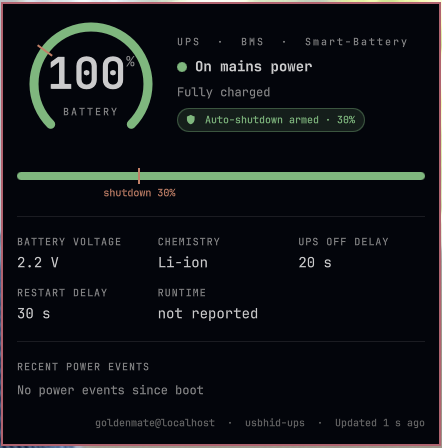

# UPS (NUT) for Omarchy

A bar widget for the Omarchy shell that shows your UPS at a glance, from
[Network UPS Tools (NUT)](https://networkupstools.org/).



- **Bar icon:** a plugged-in battery while on mains power. When the power
  fails it switches to a draining battery icon with the charge (`󰁾 62%`) in the
  urgent colour. It also turns urgent when the UPS stops answering or NUT's
  shutdown monitor isn't running.
- **Panel** (click the icon):
  - a charge ring and bar, marked at the point where NUT shuts the computer down
  - power state: on mains (charging / fully charged), or on battery with how long it has been
  - an **Auto-shutdown armed** badge, green while `nut-monitor` is running
  - live readings, showing whichever ones your UPS reports: load, power draw, runtime,
    input/output voltage, frequency, temperature, battery voltage and chemistry,
    capacity, and the UPS's shutdown/restart delays
  - recent power events since boot: power lost, power restored, battery low,
    shutdown, and lost or restored contact with the UPS
- Middle-click the icon to refresh.

## Requirements

This plugin only **reads** NUT; it does not install or configure it. You need:

1. NUT installed and your UPS configured, for example on Arch:
   `sudo pacman -S nut`, then a section for your UPS in `/etc/nut/ups.conf`, and
   `upsd` + `upsmon` set up (see the [Arch Wiki NUT page](https://wiki.archlinux.org/title/NUT)).
2. `upsc -l` lists your UPS, and `upsc <name>` prints its variables.
3. For the auto-shutdown badge: the `nut-monitor` systemd service (`upsmon`).
4. For the events list: read access to the system journal for `nut-monitor`
   (on Arch, members of `wheel` have it).

## What it runs

Everything runs as your user, inside the Omarchy shell. No privileges, no network:

| Command | When | Why |
|---|---|---|
| `upsc -l` | once, if no UPS is configured | find the first local UPS |
| `upsc <ups>` | every 5 s (configurable) | the UPS's status and readings |
| `systemctl is-active nut-monitor.service` | every 5 s | whether auto-shutdown is armed |
| `journalctl -b -u nut-monitor.service …` | when the panel opens or power changes | recent power events |

Values from these commands are shown as plain text.

## Install

```bash
omarchy plugin add https://github.com/tawman/omarchy-nut-ups.git --enable
```

## Configure

In `~/.config/omarchy/shell.json`, on the widget's bar entry:

```json
{ "id": "io.github.tawman.nut-ups", "ups": "myups@localhost", "pollSeconds": 5 }
```

- `ups`: the NUT UPS as `name@host`. Leave it out to use the first UPS on this machine.
- `pollSeconds`: how often to read the UPS (2–60, default 5).

Note: the shutdown mark is NUT's `battery.charge.low`. Many cheap UPSes report no
low-battery point (or a fake runtime); set one in `ups.conf` with
`ignorelb` and `override.battery.charge.low = 30` so NUT shuts down in time.

## Remove

```bash
omarchy plugin remove io.github.tawman.nut-ups
```

## License

MIT
